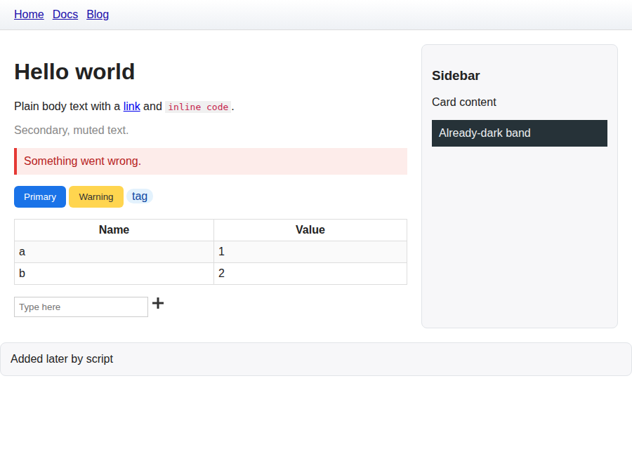
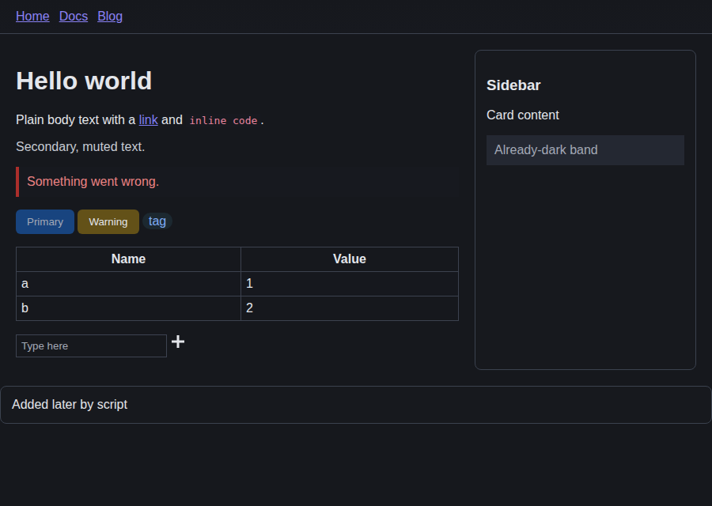
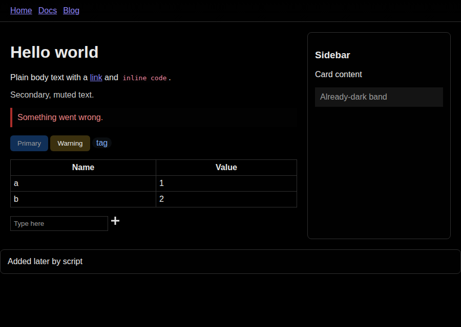
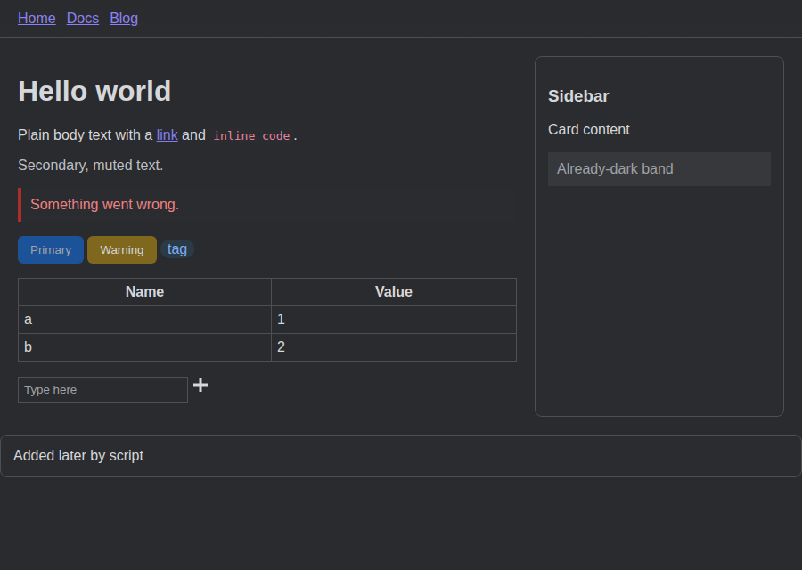
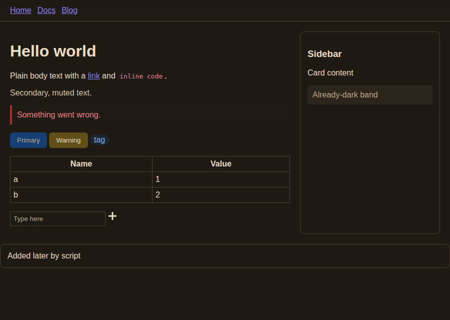
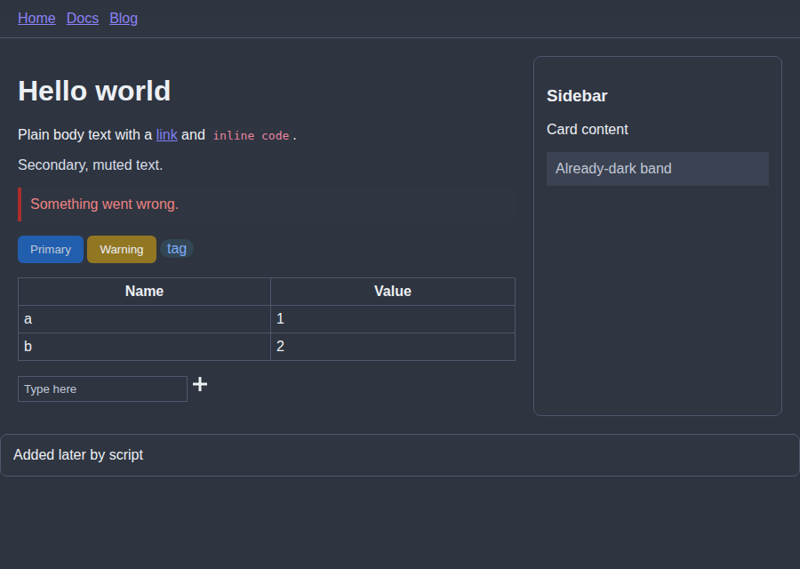
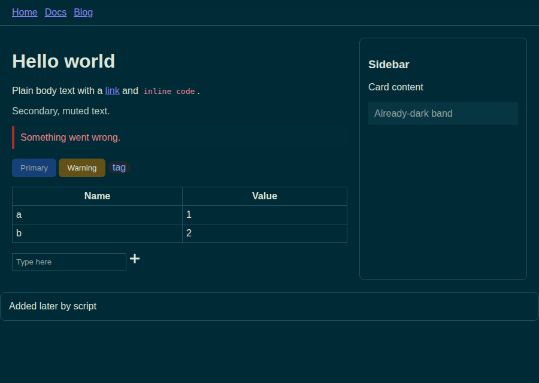

<p align="center">
  
</p>

<h1 align="center">Midnight Fox</h1>

<p align="center">
  <a href="https://github.com/danielonet/midnight-fox/actions/workflows/ci.yml"></a>
  <a href="https://github.com/danielonet/midnight-fox/actions/workflows/release.yml"></a>
  <a href="https://github.com/danielonet/midnight-fox/releases/latest"></a>
  <a href="LICENSE"></a>
  <br>
  
  
  
  
  
  
  <a href="https://github.com/danielonet/midnight-fox/pulls"></a>
</p>

A Firefox extension that gives every website a dark mode. Sites that already
have a dark mode are left alone; sites that don't get their colour palette
remapped into a dark theme of your choice.

## Features

- **6 dark themes:** Midnight, OLED Black, Dim Grey, Sepia Night, Nord, Solarized Dark
- **Respects native dark mode:** Firefox asks every site for `prefers-color-scheme: dark`.
  Pages that already look dark are detected and left untouched.
- **Palette remapping, not inversion.** Each element's computed colours are
  translated into the theme:
  - white and light backgrounds become the theme's background and surface colours
  - dark text becomes the theme's text colour
  - coloured buttons, links and alerts keep their hue
  - images are never inverted
  - `:hover` and `:focus` colours from the page's stylesheets are remapped too
- **Live updates:** content added later (infinite scroll, single-page apps) is darkened as it appears.
- **Per-site control:** *Auto* / *Always* / *Never*.
- **Adjustable:** background brightness, text contrast, and an optional image dimmer.
- **Keyboard shortcuts:** <kbd>Alt</kbd>+<kbd>Shift</kbd>+<kbd>D</kbd> toggles the current
  site; <kbd>Alt</kbd>+<kbd>Shift</kbd>+<kbd>M</kbd> toggles everything.

## Screenshots

Captured by the Playwright test suite (`node test/run.js docs/screenshots`) on a
fixture page, before and after the content script runs.

| Original page | Midnight |
| :---: | :---: |
|  |  |

| OLED Black | Dim Grey |
| :---: | :---: |
|  |  |

| Sepia Night | Nord |
| :---: | :---: |
|  |  |

| Solarized Dark |
| :---: |
|  |

## Install (development)

1. Open `about:debugging#/runtime/this-firefox` in Firefox (140 or newer).
2. Click **Load Temporary Add-on…** and select `manifest.json` from this folder.
3. If Firefox asks for website access, allow it. You can also allow it from the popup.

For development: `npm install`, then `npm start` opens a Firefox profile with
the extension loaded. `npm run build` creates the zip in `web-ext-artifacts/`.

## How it works

| File | Role |
| --- | --- |
| `src/palette.js` | Theme definitions and colour maths (shared code) |
| `src/content.js` | Detects pages that are already dark, remaps colours, watches for changes |
| `src/background.js` | Requests sites' own dark mode, handles shortcuts and the strict-CSP fallback |
| `popup/` | Toolbar popup: theme picker, site mode, sliders |

The content script reads each element's computed `color`, `background-color`,
gradient, border and SVG `fill`/`stroke`. It maps them through the theme and
groups identical results into generated rules such as
`[data-midnight-fox="12"] { color: …!important }`. Each element gets the
matching attribute. Text colour is only set where it differs from the parent,
so the number of rules stays small. When you switch themes, the rules are
regenerated without scanning the page again.

## Tests

```sh
npm install
npx playwright install chromium   # once
npm test          # runs the content script on test pages in headless Chromium
npm run lint      # Mozilla's add-on validator
```

## Publishing to addons.mozilla.org

Two GitHub Actions workflows handle this:

- **CI** (`.github/workflows/ci.yml`) runs on every push and pull request.
  It checks versions, runs Mozilla's validator, runs the tests and uploads the
  unsigned zip.
- **Release** (`.github/workflows/release.yml`) runs when a `v*.*.*` tag is pushed.
  It runs CI, submits the build to addons.mozilla.org (AMO) and creates a
  GitHub release with the package.

### One-time setup

1. Sign in at <https://addons.mozilla.org/developers/> and accept the developer agreement.
2. Create API credentials at <https://addons.mozilla.org/developers/addon/api/key/>.
3. In GitHub, go to **Settings → Environments**, create an environment named `amo`, and add two secrets:
   - `AMO_JWT_ISSUER`: the "JWT issuer" value
   - `AMO_JWT_SECRET`: the "JWT secret" value

   Optionally, add yourself as a required reviewer so every release waits for your approval.
4. Check the listing details in `amo-metadata.json` (summary, category, licence).
   They are sent with every submission.

### Releasing a version

```sh
npm run version:set -- 1.1.0          # updates manifest.json + package.json
git commit -am "Release v1.1.0"
git tag v1.1.0
git push --follow-tags
```

The workflow fails if the tag doesn't match the version in `manifest.json`.
Public ("listed") versions go into Mozilla's review queue. The job doesn't wait
for review to finish; you get an email from AMO when the version is approved.

To get a signed `.xpi` for self-distribution instead, run the **Release**
workflow manually from the Actions tab and choose the `unlisted` channel.

## Known limitations

- Colours inside `::before` / `::after` pseudo-elements and cross-origin
  stylesheets' `:hover` rules aren't remapped.
- Text drawn into images or `<canvas>` can't be recoloured. Use **Dim images** to soften bright images.
